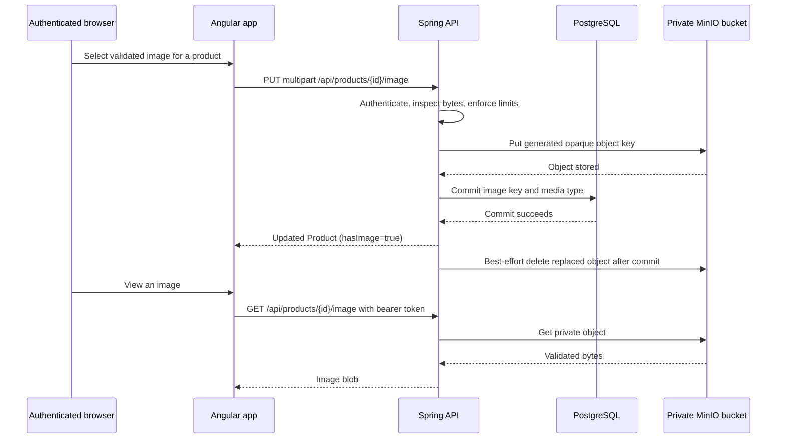

# Product image storage — specification

## Status

**PLANNED — product-policy decisions approved; no implementation or verification evidence exists.** This document governs product images only; it does not change the separate proposed profile-picture feature.

## Outcome and boundaries

Any authenticated user can add, replace, retrieve, or remove one private image for a product. PostgreSQL stores metadata only; MinIO stores binary objects in a private bucket. Spring is the only MinIO client and owns its credentials. Angular obtains image bytes through the authenticated API, never through a public object URL or browser-exposed MinIO credential.

The feature excludes public sharing, generated thumbnail objects, transformations/cropping, galleries, direct-to-MinIO uploads, third-party hosting, retention periods, and profile-picture changes. The browser may scale the one original image for a compact list preview. Existing JSON create/update product bodies and product-lifecycle event payloads remain unchanged.

## Approved policy

| Decision | Approved behavior |
|---|---|
| Viewer authorization | Only authenticated users may retrieve product images. |
| Mutation authorization | Any authenticated user may add, replace, or remove an image, consistent with existing product-write behavior. |
| Image cardinality | One original image per product; no thumbnails, cropping, or gallery. |
| Accepted content | Byte-verified JPEG, PNG, or WebP; maximum 5 MiB. Reject SVG, GIF, animated media, malformed images, spoofed content types, and oversized decoded dimensions. |
| Product deletion | Deleting a product removes its image from active use and triggers object deletion after the database transaction commits. |
| Object visibility | The MinIO bucket is private; keys never appear in browser responses. |

## Architecture and failure ownership

The Spring-to-MinIO adapter is the only Resilience4j boundary. It has an explicit timeout, a circuit breaker, and retry only for safe operations. Reads may retry after transient network failures. Deletes may retry because deleting an absent opaque key is a successful cleanup outcome. Uploads use a generated key and retry only when the adapter can distinguish a transient transport failure from an ambiguous completed write; it must never create another key on retry. Do not retry the product database transaction, controller, or whole request.

The initial configuration is a three-second storage-call timeout, circuit evaluation after at least five calls, a 50% failure threshold, and a 30-second open interval. Exercise those values in a controlled outage before tuning them. Expose circuit metrics through Actuator; retain the existing development-only diagnostics policy.

MinIO and PostgreSQL cannot share a transaction. Replacement stores the new object before committing metadata. If metadata commit fails, delete the new object best-effort and record any cleanup failure for reconciliation. Delete replaced or product-owned objects only after commit. A reconciliation job removes unreferenced product objects after a grace period; cleanup failure never restores a deleted product or changes a successful replacement response.

## Public contract to add

`docs/openapi.yaml` is authoritative and must be extended in the same change as controllers, Angular models, and tests. It does not currently describe product endpoints.

| Operation | Authorization and request | Success | Recoverable failure |
|---|---|---|---|
| `PUT /api/products/{id}/image` | Bearer token; `multipart/form-data` with one `file` part | `200` updated `Product` with `hasImage: true` | `400` invalid/missing/disallowed bytes; `413` too large; `401` unauthenticated; `404` missing product; `503` unavailable/open storage circuit. The prior image remains active. |
| `GET /api/products/{id}/image` | Bearer token | `200` image bytes with server-detected media type and `Cache-Control: private` | `401` unauthenticated; `404` no image or unavailable referenced object; `503` unavailable/open circuit. |
| `DELETE /api/products/{id}/image` | Bearer token | `204`; metadata no longer references an image | `401` unauthenticated; `404` missing product/no image; `503` if metadata cannot safely change. Object cleanup follows commit. |

Every existing product response adds `hasImage: boolean`. It is present in list, get, create, and update responses. Never return raw MinIO keys, bucket names, storage exceptions, or presigned URLs.

Angular cannot use this JWT-protected endpoint directly as an HTML `img` `src`. A focused image API/view service fetches the blob through `HttpClient`, creates an in-memory object URL for rendering, and revokes it when input changes or the owning component is destroyed. Logout clears image-view state with authentication state.

## Data and deployment contract

Flyway adds nullable `image_key VARCHAR(255)` and `image_media_type VARCHAR(32)` to `product`; no BLOB, PostgreSQL large object, or MinIO credential is stored in the database. `Product` maps ordinary strings; `ProductDto` derives `hasImage` from `image_key != null`. Entity, migration, DTO, and OpenAPI schema are one compatibility contract.

Compose adds private MinIO with a named volume, health check, and deterministic private-bucket bootstrap. Backend configuration receives endpoint, bucket, access key, and secret through environment variables. `.env.example` documents local-only placeholders; Angular receives none. Production-like Compose keeps MinIO off host ports by default.

## Delivery surfaces and acceptance scenarios

| Capability | Surface | Acceptance scenario | Required evidence |
|---|---|---|---|
| Private metadata | API/contract | Product responses include `hasImage`; no response exposes key, bucket, or credential. | Red-to-Green serialization/controller tests and OpenAPI review. |
| Upload and replacement | API/contract | Valid JPEG/PNG/WebP succeeds; invalid bytes, SVG/GIF, mismatched MIME, malformed multipart, and oversized input leave the prior reference unchanged. | Red-to-Green storage-service and MockMvc tests. |
| Private retrieval | API/contract | Authenticated request gets server-detected bytes; unauthenticated is `401`; no image is `404`. | Security/controller tests. |
| Storage failure | API/contract | Timeout, open circuit, and unavailable MinIO return recoverable `503` and retain valid metadata. | Controlled adapter/Resilience4j and outage integration tests. |
| Product delete cleanup | API/contract | Product deletion commits independently of temporarily unavailable cleanup; reconciler removes orphan objects. | Transaction, cleanup, and reconciliation tests. |
| Upload/edit UI | Browser UI | Edit form validates selection, shows progress/current image, preserves prior image after failure, and offers retry. | Red-to-Green Angular component tests. |
| Product list UI | Browser UI | A compact accessible preview of the original image appears when present; failed fetch renders an accessible placeholder without breaking table layout. | Angular component tests and responsive browser evidence. |
| Authenticated journey | Browser-to-API | User uploads, replaces, reloads, and sees an image after backend restart; after logout, image fetches fail and object URLs clear. | Compose browser E2E. |
| Realtime | N/A | Image operations do not publish current product-lifecycle events; HTTP remains authoritative. | Event-contract/source review. |
| Operations | Runtime | MinIO persists with its named volume; cold/cached builds, health checks, and outage behavior match this plan. | Compose smoke extension and outage journey. |

## Implementation sequence and gates

1. Extend `docs/openapi.yaml` with multipart schemas, security, `hasImage`, error statuses, and retry semantics.
2. Add MinIO Compose configuration, private bucket bootstrap, local variables, health checks, and configuration binding.
3. Write Red backend tests for validation, authorization, outages, replacement compensation, cleanup, and JSON shape.
4. Add the Flyway migration and matching JPA/DTO mapping; validate an empty isolated PostgreSQL database with Hibernate validation enabled.
5. Implement storage adapter, Resilience4j policy, endpoints, post-commit cleanup, and reconciliation.
6. Write Red Angular tests, then add focused image API/view ownership and product form/table rendering without changing existing validation ownership.
7. Run API, Angular, OpenAPI, PostgreSQL, Compose, and browser evidence. Mark this feature `DONE` only when every applicable scenario is green.

- Backend: focused tests, then `cd backend && mvn --batch-mode --no-transfer-progress test`.
- Database: isolated PostgreSQL migration plus Hibernate schema validation; H2 is supplementary only.
- Frontend: focused image tests, full Angular tests with a browser/spec summary, TypeScript checks, and production build.
- Runtime: `docker compose config --quiet`, cold and repeated cached builds, authenticated upload/replacement/delete/restart E2E, and a controlled MinIO outage/open-circuit journey.
- Quality: validate this Mermaid diagram with the repository command when available, run `git diff --check`, and update roadmap evidence only from actual green results.

## Implementation approval

Product policy is approved as recorded above. This plan does not authorize MinIO provisioning outside local Compose, dependency installation, migrations against existing data, or a production deployment.
