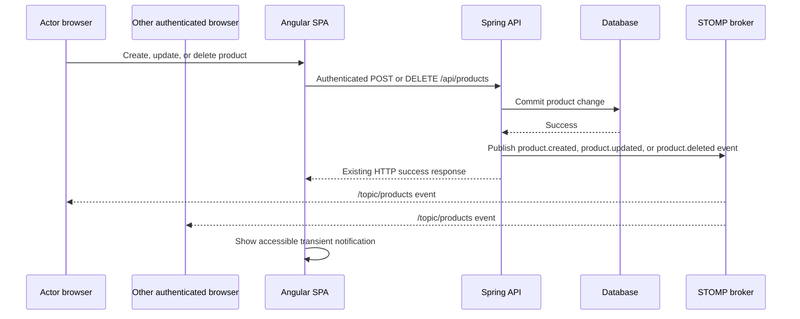

# Profile editing and product lifecycle notifications — specification

## Status

**PROFILE REVISION PROPOSED — requires approval before implementation.** Product lifecycle notifications remain an independent in-progress slice.

This plan retains **product-created, product-updated, and product-deleted notifications** as a separate slice and revises the existing username-renaming profile API. The current application has profile and realtime implementation artifacts, but it has no display-name or profile-picture data/storage contract; those are new authenticated capabilities.

## Outcome and boundaries

An authenticated user can view their own stable username, set a custom display name, and upload or replace a profile picture. The username is a unique login identifier and is never editable through the profile feature. Authenticated users receive an accessible, transient in-app notification when a product is successfully created, updated, or deleted by any authenticated user, including themselves.

The work preserves the existing product CRUD URLs, JWT bearer authentication, role behavior, proxy topology, and database profiles. It retires the unapproved username-renaming behavior from the existing profile endpoint and replaces its response shape. It does not add email/push notifications, notification persistence or history, user administration, password reset, a global audit log, image editing/cropping, third-party media hosting, or a public user directory.

## Proposed delivery decisions

| Decision | Recommended initial scope | Why approval is needed |
|---|---|---|
| Stable username | Show username read-only; do not accept it in profile updates. Existing JWT subjects therefore remain valid after display-name or picture changes. | This replaces the current username-renaming contract and removes duplicate-username/session-invalidation behavior from profile editing. |
| Editable profile fields | `displayName` and one profile picture; exclude password, roles, username, image cropping, and galleries. | Defines the ownership and makes a single image replacement deterministic. |
| Picture storage and visibility | **Decision required:** use application-managed durable object storage, with an opaque stored key and a media endpoint; decide whether authenticated viewers only or anyone with the opaque URL may view it. | Docker's current backend filesystem is ephemeral; public/private media changes authorization, cache headers, and deployment configuration. |
| Image safety limits | Proposed: JPEG, PNG, or WebP only; verified from bytes, maximum 5 MiB, dimensions capped during decode, and no SVG/GIF/animated input. | File names and client MIME headers are untrusted; decoding limits prevent oversized-image resource exhaustion. |
| Notification audience | All currently connected authenticated users, including the actor. | Excluding the actor or limiting by role changes the user-visible contract. |
| Notification delivery | Ephemeral WebSocket/STOMP broadcast; no catch-up after reconnect. | Durable/inbox notifications require schema, retention, read state, and retry policy. |
| Delete payload | Send the deleted product's id and name captured before deletion; never expose deleted entity details beyond those fields. | Determines the client contract and data-minimization boundary. |

If the requester means **production-environment deployment notifications**, this specification does not apply and must be replaced before implementation.

## Proposed architecture



The transaction boundary is intentional: publish only after the database operation succeeds. For this single-process application, an after-commit application event listener is sufficient for the initial scope. If reliable cross-process delivery becomes a requirement, replace it with an outbox and a durable broker; do not claim this broadcast is an audit trail.

On the frontend, `ProductNotificationsService` solely owns STOMP connection, subscription, reconnect cleanup, and parsing. A focused layout-owned `NotificationCenterComponent` renders notification state. Product form/list components retain HTTP ownership and do not open sockets. This keeps the root template as layout parent and routed content as child content.

## Public interfaces

### Profile HTTP contract revision (proposed)

| Operation | Contract | Success | Validation / recoverable failure |
|---|---|---|---|
| Read own profile | `GET /api/auth/me` | `200 { "username": string, "displayName": string, "profilePictureUrl": string \| null }` | `401` follows existing logout behavior. Username is returned for display only. |
| Update display name | `PUT /api/auth/me` with `{ "displayName": string }` | Returns the complete profile. The bearer token remains valid. | `400` for blank/overlength display name; network/server failure leaves the typed name available for retry. Unknown/malformed fields are rejected or ignored according to the approved JSON policy. |
| Upload/replace picture | `PUT /api/auth/me/profile-picture` as `multipart/form-data`, one `file` part | Returns the complete profile with a new opaque media URL. Replacement is atomic: the old image remains usable until the new one is durably stored and profile metadata commits. | `400` for missing/invalid image or exceeded limits; `413` for a body exceeding the configured request limit; `401` unauthenticated; storage failure returns a recoverable `5xx` without changing the current picture. |
| Retrieve picture | `GET /api/profile-pictures/{opaqueKey}` | Streams only the stored, validated image with its server-detected media type and safe cache headers. | `404` unknown/removed key; authorization behavior depends on the storage-and-visibility decision above. |

`username` stays unique, non-null, and immutable after account creation. Add `display_name` and nullable picture-key/media-type metadata through a Flyway migration (no image BLOB in the user table). Display-name limits must be identical in JPA, Bean Validation, Angular validators, and the migration. The database remains the authority for username uniqueness at account creation; this profile update no longer has a duplicate-username path.

The existing `PUT /api/auth/me { username }` and its `409` behavior must be removed in the same approved change as the Angular client/tests and OpenAPI contract. This is a same-application contract revision, not a compatible additive change; do not deploy only one side.

### Profile update and upload sequence

```mermaid
sequenceDiagram
  participant U as Authenticated browser
  participant UI as Angular profile page
  participant API as Spring profile API
  participant DB as User database
  participant M as Durable media storage

  U->>UI: Enter display name or select image
  UI->>UI: Validate name or file type/size before request
  alt display name
    UI->>API: PUT /api/auth/me { displayName }
    API->>DB: Update own display_name only
    DB-->>API: Commit
    API-->>UI: Complete profile; same JWT remains valid
  else picture replacement
    UI->>API: PUT multipart /api/auth/me/profile-picture
    API->>API: Verify bytes, decode safely, apply limits
    API->>M: Store with generated opaque key
    M-->>API: Durable write
    API->>DB: Commit new picture metadata
    DB-->>API: Commit
    API-->>UI: Complete profile with picture URL
    API->>M: Best-effort cleanup of replaced object
  end
```

If metadata commit fails after a successful media write, the API returns failure and schedules/delegates cleanup of the orphaned object; it must not expose that key in a profile response. Deletion/cleanup retry and durable object-storage choice need approval before implementation.

### Product notification contract (new)

The authenticated broker destination is `/topic/products`. A versioned, discriminated payload avoids reusing entity JSON as an event protocol:

```json
{
  "type": "product.created",
  "product": { "id": 42, "name": "Keyboard" },
  "actorUsername": "admin",
  "occurredAt": "2026-10-07T10:00:00Z"
}
```

`product.updated` and `product.deleted` have the same shape. `occurredAt` is generated by the server. Clients ignore unknown event types and malformed payloads safely, without breaking the product list. HTTP remains the source of truth: a client never writes product state directly from an event.

## Delivery surfaces and acceptance scenarios

| Capability | Surface | Scenario | Required evidence |
|---|---|---|---|
| Profile identity/display name | API/contract | Authenticated caller reads their username but cannot change it; can update only their display name; blank/overlong input is `400`; unauthenticated request is `401`; current JWT remains valid. | Red-to-Green MockMvc tests, including request that tries to send `username`. |
| Profile picture | API/contract | Authenticated caller uploads a valid image; invalid MIME-bytes, SVG/GIF, oversized body, and malformed multipart fail without changing the profile; a replacement returns a fresh URL; authorization/404 behavior follows the approved visibility policy. | Red-to-Green MockMvc/service tests plus a storage fake/contract test. |
| Profile edit | Browser UI | Profile shows read-only username, editable display-name field, current picture/fallback initials, preview only after local validation, explicit upload progress, and field/generic recoverable errors that preserve entered state. | Red-to-Green Angular component tests, including invalid image and failed replacement. |
| Profile edit | Browser-to-API | User changes display name and refreshes/reopens the app to see it; uploads/replaces a picture and sees it after refresh; failed upload leaves the previous picture and selected display name intact; session remains authenticated. | Browser E2E against dev Compose and production-profile smoke extension. |
| Profile edit | Realtime | N/A — profile editing neither emits nor consumes product lifecycle events. | Design review/source inspection. |
| Product lifecycle notice | API/contract | Existing product POST/PUT/DELETE responses remain unchanged; a committed create/update/delete emits exactly one correctly shaped event; a failed mutation emits none. | Spring integration tests with broker/event listener test double. |
| Product lifecycle notice | Browser UI | Connected user sees a readable `role=status` notification identifying create/update/delete and product name; it disappears after 5 seconds and can be dismissed. | Red-to-Green Angular notification component/service tests. |
| Product lifecycle notice | Browser-to-API | Actor creates/updates/deletes through the existing UI and receives the normal HTTP result; a second browser receives the event without reload and can refresh to confirm current data. | Two-browser E2E through Compose. |
| Product lifecycle notice | Realtime | Client connects only after authentication, subscribes once, reconnects without duplicate notices, and disconnects/clears state on logout. Unauthorized socket attempts are rejected. | Backend WebSocket-security tests plus Angular lifecycle tests and two-browser E2E. |

## Implementation sequence

1. Approve the storage/visibility, cleanup, display-name length/default, and replacement/remove-picture decisions above. Do not start upload implementation without the durable media-storage decision.
2. Amend `docs/openapi.yaml` and this specification together: remove username update/`409`, add display name and the multipart/media contracts, and add the same behavior to the Angular typed model before application code.
3. Build profile revision test-first: migration/entity constraints, profile service/controller, byte verification/storage abstraction/uniform errors, then Angular service, route, form, preview, and header/avatar rendering.
4. Add the WebSocket/STOMP dependency and explicit security configuration: JWT authentication during the CONNECT handshake, authenticated subscription authorization, allowed origins matching the existing deployment, and no anonymous topic access.
5. Publish lifecycle events after successful product transactions; add focused service/controller event tests before the broker wiring.
6. Add one lifecycle-owning Angular realtime service and the layout-level notification component; wire cleanup to logout and application destruction.
7. Run contract, backend, Angular, and two-browser Compose evidence; update this document and `ROADMAP.md` only with actual green results.

## Verification gates

- Backend: targeted MockMvc/storage tests, transaction/event, and WebSocket authorization tests; then `mvn --batch-mode --no-transfer-progress test`.
- Frontend: targeted profile and notification specs, then full Angular tests, TypeScript checks, and `npm run build`. A Karma run without a browser/spec summary remains inconclusive.
- Runtime: cold Docker Compose build, repeated cached build, and an authenticated browser journey that proves an uploaded picture survives a backend restart and follows the approved media authorization behavior. The Dockerfiles must retain manifest-first copies and cache mounts; report cache timing/log evidence rather than image size.
- Quality: `git diff --check`; validate Mermaid only if the repository gains a Mermaid validation command (none exists today).

## Deferred scope and risks

- STOMP simple broker notifications are best-effort and do not survive server restart or reconnect.
- Multi-instance production delivery, durable notifications, read state, browser push, and notification preferences require a separate design.
- Profile-picture removal, old-object cleanup retries, image transformations/thumbnails, content scanning, retention, and GDPR deletion are deferred until their policy and storage ownership are specified.
- The existing username-renaming implementation and tests conflict with this approved-direction revision. They remain implementation debt until this plan is approved and delivered; do not describe the profile feature as complete.
