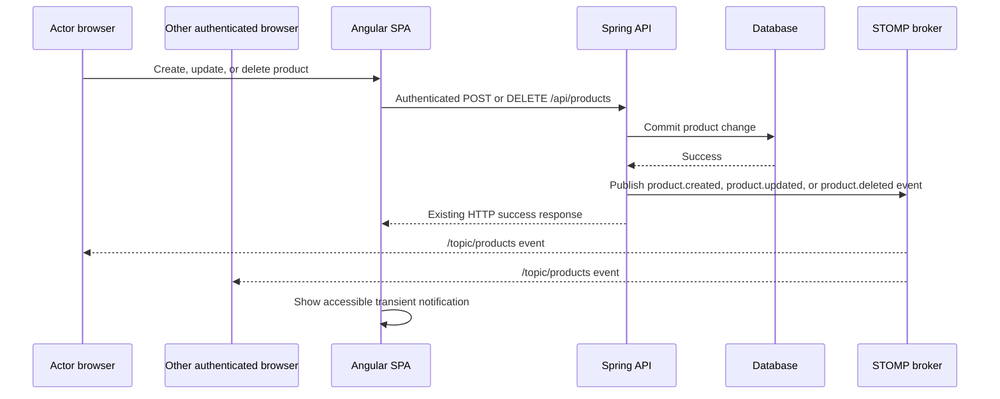

# Profile editing and product lifecycle notifications — proposed specification

## Status

**APPROVED — product lifecycle notification slice in implementation.**

This plan implements **product-created, product-updated, and product-deleted notifications**. The current application has no realtime transport, notification model, or profile API; therefore this is a new authenticated HTTP and realtime capability, not an extension of an existing protocol.

## Outcome and boundaries

An authenticated user can view and update their own profile. Authenticated users receive an accessible, transient in-app notification when a product is successfully created, updated, or deleted by any authenticated user, including themselves.

The work preserves the existing product CRUD URLs, request/response JSON, JWT bearer authentication, role behavior, proxy topology, and database profiles. It does not add email/push notifications, notification persistence or history, user administration, password reset, or a global audit log.

## Decisions required before implementation

| Decision | Recommended initial scope | Why approval is needed |
|---|---|---|
| Editable profile fields | Display name / username only; exclude password and roles. | Changing a login identifier affects active sessions, duplicate handling, and whether a new JWT is required. |
| Username update session rule | On a successful username change, invalidate the old token and require sign-in with the new username. | The existing JWT subject is the username; retaining it would create an identity mismatch. |
| Notification audience | All currently connected authenticated users, including the actor. | Excluding the actor or limiting by role changes the user-visible contract. |
| Notification delivery | Ephemeral WebSocket/STOMP broadcast; no catch-up after reconnect. | Durable/inbox notifications require schema, retention, read state, and retry policy. |
| Delete payload | Send the deleted product's id and name captured before deletion; never expose deleted entity details beyond those fields. | Determines the client contract and data-minimization boundary. |

If the requester means **production-environment deployment notifications**, this specification does not apply and must be replaced before implementation.

## Proposed architecture



The transaction boundary is intentional: publish only after the database operation succeeds. For this single-process application, an after-commit application event listener is sufficient for the initial scope. If reliable cross-process delivery becomes a requirement, replace it with an outbox and a durable broker; do not claim this broadcast is an audit trail.

On the frontend, `ProductNotificationsService` solely owns STOMP connection, subscription, reconnect cleanup, and parsing. A focused layout-owned `NotificationCenterComponent` renders notification state. Product form/list components retain HTTP ownership and do not open sockets. This keeps the root template as layout parent and routed content as child content.

## Public interfaces

### Profile HTTP contract (new)

| Operation | Contract | Success | Validation / recoverable failure |
|---|---|---|---|
| Read own profile | `GET /api/auth/me` | `200 { "username": string }` | `401` follows existing logout behavior. |
| Update own profile | `PUT /api/auth/me` with `{ "username": string }` | `200 { "username": string }`; recommended policy logs out afterward. | `400` for blank/overlength username; `409` for an already-used username; network/server failure leaves entered value available for retry. |

The username limits must be identical in JPA, Bean Validation, Angular validators, and the database migration. The existing unique constraint remains the final concurrency authority; map its violation deterministically to `409` rather than leaking a persistence exception.

### Product notification contract (new)

The authenticated broker destination is `/topic/products`. A versioned, discriminated payload avoids reusing entity JSON as an event protocol:

```json
{
  "type": "product.created",
  "product": { "id": 42, "name": "Keyboard" },
  "actorUsername": "admin",
  "occurredAt": "2026-10-07T10:00:00Z"
}
```

`product.updated` and `product.deleted` have the same shape. `occurredAt` is generated by the server. Clients ignore unknown event types and malformed payloads safely, without breaking the product list. HTTP remains the source of truth: a client never writes product state directly from an event.

## Delivery surfaces and acceptance scenarios

| Capability | Surface | Scenario | Required evidence |
|---|---|---|---|
| Profile edit | API/contract | Authenticated caller can read and update only their own profile; request validation is stable; duplicate username returns `409`; unauthenticated request returns `401`. | MockMvc tests, including duplicate and malformed input. |
| Profile edit | Browser UI | Header offers Profile; form loads current value, blocks invalid input locally, shows field and generic recoverable errors, and preserves input on failure. | Red-to-Green Angular component tests. |
| Profile edit | Browser-to-API | User changes username, receives the defined session outcome, and can sign in using the new username. | Browser E2E against dev Compose and production-profile smoke extension. |
| Profile edit | Realtime | N/A — profile editing neither emits nor consumes product lifecycle events. | Design review/source inspection. |
| Product lifecycle notice | API/contract | Existing product POST/PUT/DELETE responses remain unchanged; a committed create/update/delete emits exactly one correctly shaped event; a failed mutation emits none. | Spring integration tests with broker/event listener test double. |
| Product lifecycle notice | Browser UI | Connected user sees a readable `role=status` notification identifying create/update/delete and product name; it disappears after 5 seconds and can be dismissed. | Red-to-Green Angular notification component/service tests. |
| Product lifecycle notice | Browser-to-API | Actor creates/updates/deletes through the existing UI and receives the normal HTTP result; a second browser receives the event without reload and can refresh to confirm current data. | Two-browser E2E through Compose. |
| Product lifecycle notice | Realtime | Client connects only after authentication, subscribes once, reconnects without duplicate notices, and disconnects/clears state on logout. Unauthorized socket attempts are rejected. | Backend WebSocket-security tests plus Angular lifecycle tests and two-browser E2E. |

## Implementation sequence

1. Approve the five decisions above, especially the exact profile fields and notification audience.
2. Add the new public contract to this specification and, if adopted, an OpenAPI document before application code.
3. Build profile editing test-first: migration/entity constraints as needed, profile service/controller, uniform errors, then Angular service, route, form, and header navigation.
4. Add the WebSocket/STOMP dependency and explicit security configuration: JWT authentication during the CONNECT handshake, authenticated subscription authorization, allowed origins matching the existing deployment, and no anonymous topic access.
5. Publish lifecycle events after successful product transactions; add focused service/controller event tests before the broker wiring.
6. Add one lifecycle-owning Angular realtime service and the layout-level notification component; wire cleanup to logout and application destruction.
7. Run contract, backend, Angular, and two-browser Compose evidence; update this document and `ROADMAP.md` only with actual green results.

## Verification gates

- Backend: targeted MockMvc, transaction/event, and WebSocket authorization tests; then `mvn --batch-mode --no-transfer-progress test`.
- Frontend: targeted profile and notification specs, then full Angular tests, TypeScript checks, and `npm run build`. A Karma run without a browser/spec summary remains inconclusive.
- Runtime: cold Docker Compose build, repeated cached build, and a two-browser authenticated journey. The Dockerfiles must retain manifest-first copies and cache mounts; report cache timing/log evidence rather than image size.
- Quality: `git diff --check`; validate Mermaid only if the repository gains a Mermaid validation command (none exists today).

## Deferred scope and risks

- STOMP simple broker notifications are best-effort and do not survive server restart or reconnect.
- Multi-instance production delivery, durable notifications, read state, browser push, and notification preferences require a separate design.
- Username rename must be coordinated with any future audit/event actor model; events should record the actor value at the time of the action.
